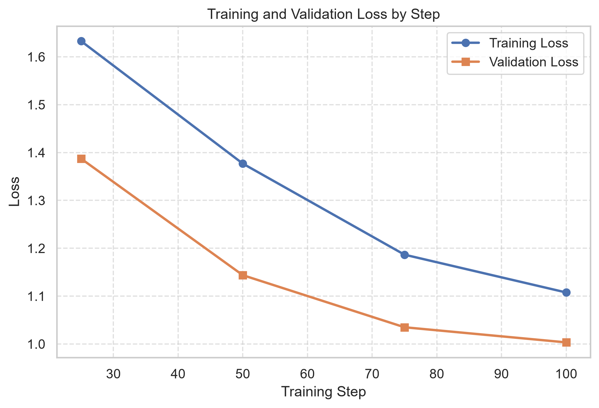
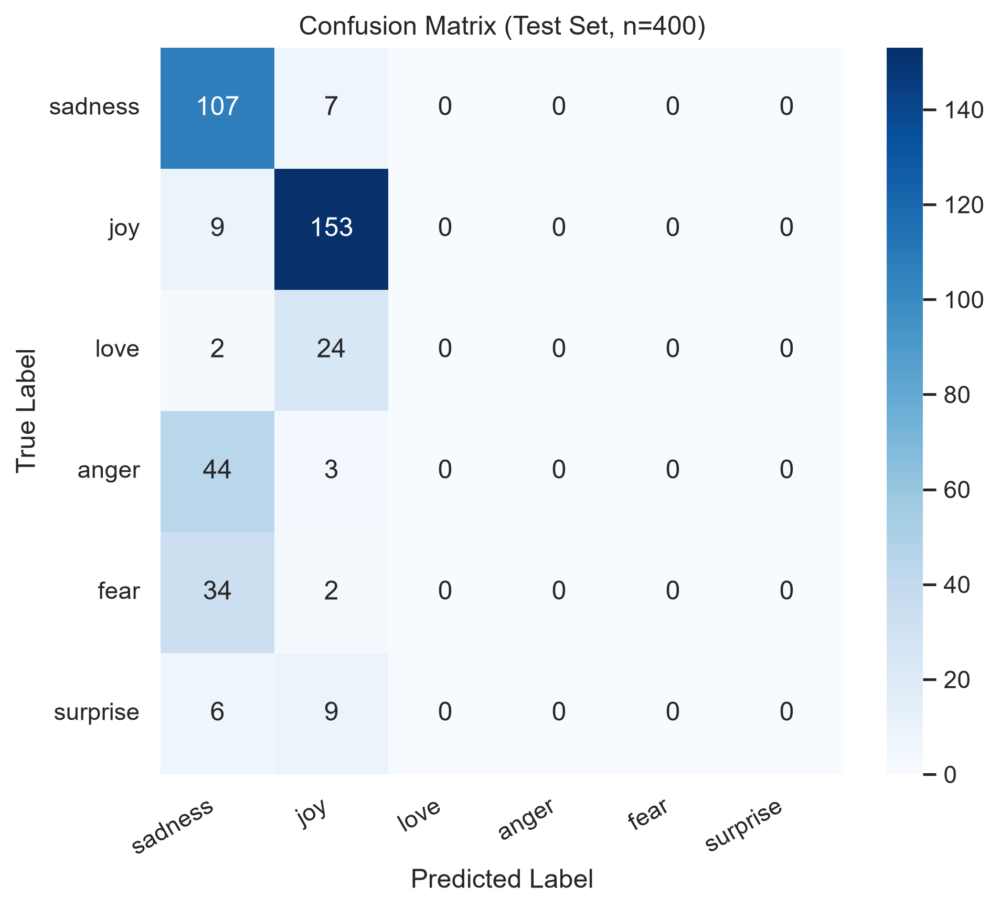
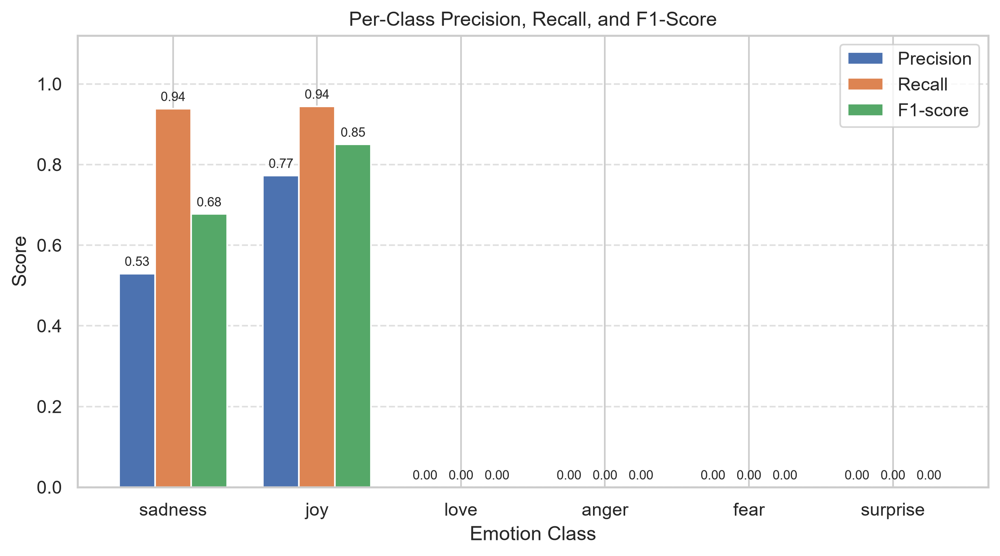

# DistilBERT Emotion Classifier

## Overview

This repository demonstrates 6-class text emotion classification via transfer learning with `distilbert-base-uncased` on a 2,000-sample subset of the `dair-ai/emotion` dataset. The project covers data loading, tokenization, fine-tuning with Hugging Face `Trainer`, step-level loss tracking, full evaluation diagnostics (metrics and plots), and sample inference inside a single reproducible notebook.

## Dataset

The data comes from the Hugging Face `dair-ai/emotion` dataset (16,000 train, 2,000 validation, 2,000 test English tweets labeled with 6 emotions). To keep CPU training runs fast and reproducible, the notebook shuffles the original splits with `seed=42` and takes a fixed subset:

- **Train split**: 1,600 samples
- **Test split**: 400 samples
- **Random seed**: `42`

The dataset is strongly imbalanced, with `joy` and `sadness` accounting for 61.9% of the training subset and 69.0% of the test subset:

| Class ID | Emotion | Train Count | Train Share | Test Count | Test Share |
| --- | --- | ---: | ---: | ---: | ---: |
| 0 | `sadness` | 460 | 28.8% | 114 | 28.5% |
| 1 | `joy` | 531 | 33.2% | 162 | 40.5% |
| 2 | `love` | 124 | 7.8% | 26 | 6.5% |
| 3 | `anger` | 215 | 13.4% | 47 | 11.8% |
| 4 | `fear` | 206 | 12.9% | 36 | 9.0% |
| 5 | `surprise` | 64 | 4.0% | 15 | 3.8% |
| **Total** | | **1,600** | **100.0%** | **400** | **100.0%** |

## Model and Training Setup

- **Base architecture**: `distilbert-base-uncased` (`AutoModelForSequenceClassification`, `num_labels=6`)
- **Tokenizer**: `AutoTokenizer.from_pretrained("distilbert-base-uncased")` with dynamic padding via `DataCollatorWithPadding`
- **Max sequence length**: `64` tokens (with truncation)
- **Epochs**: `2` (100 optimizer steps total)
- **Batch size**: `32` (train and eval)
- **Learning rate**: `3e-5`
- **Weight decay**: `0.01`
- **Evaluation and logging**: `eval_strategy="steps"`, `eval_steps=25`, `logging_steps=25`
- **Seed**: `42`
- **Hardware**: CPU (runtime: ~10m 26s for 100 steps)

## Evaluation Results

Final metrics measured on the 400-sample test split after 2 epochs (100 steps):

| Metric | Score |
| --- | ---: |
| Accuracy | 0.6500 |
| Macro F1 | 0.2545 |
| Weighted F1 | 0.5373 |

Per-class breakdown from `sklearn.metrics.classification_report`:

| Class | Precision | Recall | F1-Score | Support |
| --- | ---: | ---: | ---: | ---: |
| `sadness` | 0.5297 | 0.9386 | 0.6772 | 114 |
| `joy` | 0.7727 | 0.9444 | 0.8500 | 162 |
| `love` | 0.0000 | 0.0000 | 0.0000 | 26 |
| `anger` | 0.0000 | 0.0000 | 0.0000 | 47 |
| `fear` | 0.0000 | 0.0000 | 0.0000 | 36 |
| `surprise` | 0.0000 | 0.0000 | 0.0000 | 15 |
| **Macro Avg** | **0.2171** | **0.3138** | **0.2545** | **400** |
| **Weighted Avg** | **0.4639** | **0.6500** | **0.5373** | **400** |

Step-by-step training log:

| Step | Training Loss | Validation Loss | Accuracy | Macro F1 | Weighted F1 |
| ---: | ---: | ---: | ---: | ---: | ---: |
| 25 | 1.6327 | 1.3872 | 0.5925 | 0.2310 | 0.4869 |
| 50 | 1.3768 | 1.1438 | 0.6325 | 0.2488 | 0.5260 |
| 75 | 1.1866 | 1.0349 | 0.6425 | 0.2521 | 0.5330 |
| 100 | 1.1076 | 1.0033 | 0.6500 | 0.2545 | 0.5373 |

## Visualizations

### Training and Validation Loss



Both training loss (1.63 to 1.11) and validation loss (1.39 to 1.00) decline steadily across the 100 steps, showing no overfitting. However, validation loss remains above 1.00 at step 100 and is still trending downward, which indicates underfitting under the 2-epoch / 100-step budget at `learning_rate=3e-5`.

### Confusion Matrix



All 400 test predictions fall into the two majority classes (`sadness` and `joy`). Within those classes, true positives are high (`107/114` for `sadness`, `153/162` for `joy`). Minority classes collapse into semantically related majority labels: `love` is predicted mostly as `joy` (`24/26`), `anger` (`44/47`) and `fear` (`34/36`) are predicted predominantly as `sadness`, and `surprise` splits across `joy` (`9/15`) and `sadness` (`6/15`).

### Per-Class Metrics



`joy` reaches `0.85` F1 (`0.77` precision, `0.94` recall), while `sadness` reaches `0.68` F1 (`0.53` precision, `0.94` recall - precision is pulled down by `anger` and `fear` false positives). The four minority classes score `0.00`, creating the wide gap between Accuracy (`0.6500`) and Macro F1 (`0.2545`). To recover minority-class performance in follow-up experiments, increase training steps (for example, 4-5 epochs or batch size 16), train on the full 16,000-sample split, or apply class-weighted cross-entropy loss.

## Inference Examples

Sample predictions from the fine-tuned model on three unseen English sentences:

| Input Text | Predicted Emotion | Confidence |
| --- | --- | ---: |
| "I just got the job offer I have been waiting for all year!" | `joy` | 0.7456 |
| "I cannot believe they cancelled the event without telling anyone." | `sadness` | 0.4097 |
| "Walking alone down that dark alley made my heart race." | `sadness` | 0.3293 |

Consistent with the confusion matrix, the positive sentence is confidently classified as `joy`, while the anger- and fear-leaning sentences fall back to `sadness` with low confidence (`0.41` and `0.33`).

## Repository Structure

```text
distilbert-emotion-classifier/
|-- assets/
|   |-- training_loss.png        # Training vs. validation loss by step
|   |-- confusion_matrix.png     # 6x6 confusion matrix heatmap on test split
|   `-- per_class_metrics.png    # Precision, recall, and F1 grouped bar chart
|-- emotion_finetuning.ipynb     # End-to-end training, evaluation, plots, and inference
|-- .gitignore                   # Excludes checkpoints, weights, and cache directories
`-- README.md                    # Project documentation and benchmark results
```

## How to Run

1. Clone the repository:

```bash
git clone https://github.com/adiletbtrv/distilbert-emotion-classifier.git
cd distilbert-emotion-classifier
```

2. Install the required packages (or run the first cell in the notebook):

```bash
pip install transformers datasets accelerate scikit-learn torch matplotlib seaborn jupyter
```

3. Launch Jupyter or open `emotion_finetuning.ipynb` in VS Code and run all cells in order:

```bash
jupyter notebook emotion_finetuning.ipynb
```

Executing all cells downloads the dataset and pretrained weights from Hugging Face, fine-tunes DistilBERT, prints the evaluation tables, regenerates the three PNG plots in `assets/`, and runs the sample inference cell.
